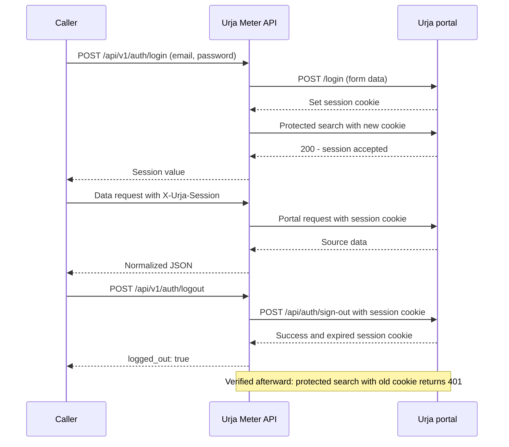
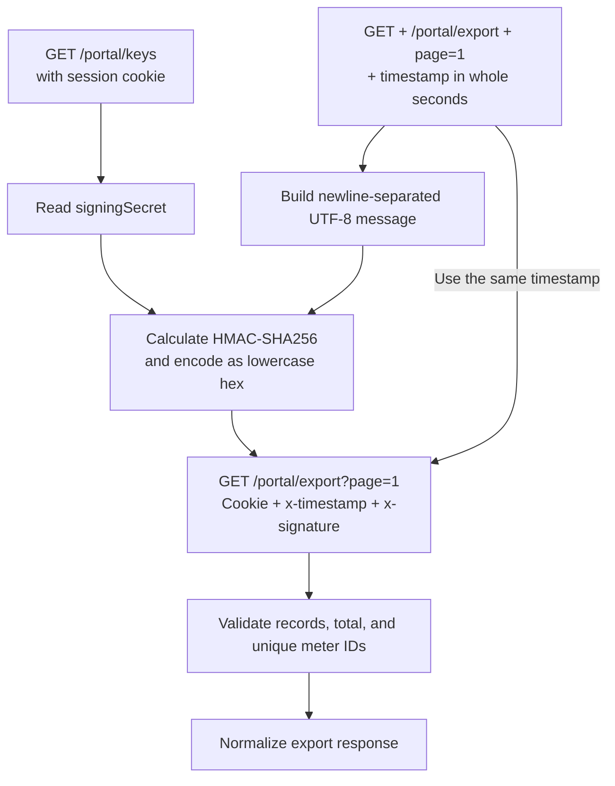

# How the Urja portal works

Portal origin: `https://urja-ops.flockenergy.tech`.

These findings come from exploring the portal in Chrome DevTools, comparing response samples, inspecting the export request construction, and replaying requests directly. Counts below describe the dataset observed during testing and may change. No credentials, session values, or signing keys are included here.

## Available data and how to reach it

The browser fetches data through several routes, and their response formats differ. Paths in this table belong to Urja; the service's public endpoints are documented in the README and OpenAPI. All routes in the table require a valid Urja session; export also requires signature headers.

| Portal request                                             | Available data                                                       | Observed format                                             |
| ---------------------------------------------------------- | -------------------------------------------------------------------- | ----------------------------------------------------------- |
| `GET /portal/meters/search?q={text}&page={page}`           | Meter ID, serial, make, phase, installation status, transformer code | JSON with `data`, `total`, `page`, `pageSize`               |
| `GET /meters/{id}/__data.json?x-sveltekit-invalidated=001` | Nameplate, installation type, network hierarchy                      | SvelteKit indexed response with two detail formats          |
| `GET /portal/meters/{id}/geo`                              | Latitude and longitude                                               | JSON; coordinates can be numeric strings                    |
| `GET /portal/meters/{id}/energy`                           | Timestamp, kWh, kVAh, R-phase voltage                                | JSON containing readings with timestamp and numeric strings |
| `GET /portal/dts?page={page}`                              | Transformer code, name, feeder code, capacity in kVA                 | Paginated JSON                                              |
| `GET /portal/keys`                                         | Signing material for export                                          | JSON containing `data.signingSecret`                        |
| `GET /portal/export?page=1`                                | Complete meter metadata, hierarchy, and coordinates                  | Signed request; JSON with `data` and `total`                |

Meter search matched full and partial IDs and serial numbers. For example, `SE11409` matched J100007, while `J1000` matched 100 meters. An empty query listed meters. The observed page size was 20. A nonexistent search returned `{"data":[],"total":0,"page":1,"pageSize":20}`. Additional attribute filters and an adjustable search page size were not established.

The transformer catalogue contained 40 records across two pages. Export returned 403 unique meter records. Export includes installation type and location details that are absent from search, but does not include the reading series. Filters, nearby search, and inventory summaries in our API are calculated from export data; they are not native Urja search features.

## Authentication and session flow



### Login

- The `/login` page has a form with `email` and `password`.
- The observed request was `POST /login` with `Content-Type: application/x-www-form-urlencoded` and same-origin `Origin` and `Referer` headers. Whether those two headers are mandatory was not tested.
- Successful login issued the `__Secure-better-auth.session_token` cookie with Secure, HttpOnly, SameSite=Lax, Path=/, and an expiry.
- HTTP 200 alone does not confirm success. A wrong password also returned 200, but the SvelteKit action body contained `type: "failure"` and `status: 401`.
- Login success was verified by making a protected search with the new cookie in a fresh client.
- The adapter follows this observed form flow; it does not infer another login route from the cookie name.

### Access to protected data

- Supplying only the named session cookie allowed access to search, detail, location, readings, and transformers.
- Sending the same value only as `Authorization: Bearer ...` returned 401.
- Without a valid session, the HTML `/meters` page returned 302 to `/login`.
- The search endpoint returned 401 with this body:

```json
{ "error": "unauthorized", "message": "A valid session is required." }
```

- The adapter accepts the cookie value through `X-Urja-Session` and attaches it as the named cookie on portal requests.
- Each operation has its own cookie jar, shared by that operation's portal calls.
- Passwords, sessions, and signing material are kept only for the request processing needed to use them. They are excluded from application logs.

### Logout

- The portal's Sign out button called `POST /api/auth/sign-out`.
- A direct request with the session cookie and same-origin `Origin` and `Referer`, without a request body, returned HTTP 200 with `{"success":true}`.
- The response expired the main session cookie and cleared the related session-data and remember-choice cookies.
- A protected search using the old session then returned 401, confirming that the supplied session stopped working.
- The adapter's logout endpoint follows this flow and does not retry the state-changing request.
- Natural session expiry, simultaneous logins, and whether logout affects other sessions have not been verified through live lifecycle tests.

## Why meter details needed special handling

The detail route returns a SvelteKit envelope containing `nodes`. Data inside a node is flattened into an indexed array: numbers such as `"meterId": 1` refer to another entry in that array, rather than being the meter ID itself. The adapter decodes this with `devalue.unflatten` and finds the relevant node by its content instead of assuming a fixed node position.

After decoding, two nameplate formats were observed:

- An older format with a parameter list.
- A newer format with a JSON string inside `detail.classData`, containing `installed_meter`.

Comparing meters with different installation statuses showed that `installed_meter` is a payload key, not an indication that the meter is installed. J100007 used that key even though its status was `Decommissioned`. Both formats are converted to the same API fields, and the meter identities are checked against the requested ID.

- **Missing meter can still return HTTP 200.** For J999999, the response contained an error node with `status: 404` and `message: "Meter not found"`. The adapter checks this embedded error and returns `404 METER_NOT_FOUND`.
- **An unexpected response is not automatically a missing meter.** If the expected data node is absent without an explicit missing-meter error, the adapter treats it as an invalid portal response and returns 502.

## Location and reading quirks

- **Names can disagree for the same code.** DT-007 had different names in the transformer catalogue and meter hierarchy. J100400 reported `Old Malviya Nagar Xfmr`. The adapter keeps the name returned by each source instead of silently replacing it.
- **Hierarchy entries can be incomplete.** Export contained names without codes and codes without names. The populated part is preserved, missing parts are represented explicitly, and warnings identify the affected records.
- **Categories need normalization.** Values such as `CT Operated` and `Whole Current` become `ct_operated` and `whole_current`. Installation status is an inventory label; it does not establish electrical health or whether readings are current.
- **Fetching again does not mean newer readings.** J100007 returned 337 readings covering `2026-06-23T23:30:00` to `2026-06-30T23:30:00`. Date filters select from the series Urja returns; fetching additional history was not established.
- **The source does not state a timezone.** We assume IST for interpretation because the data is from Jaipur. The API preserves the timestamps and returns `timestamp_timezone: null` because Urja has not confirmed that assumption.
- **Energy values appear cumulative.** kWh and kVAh values increased across the observed readings. Reset and rollover rules were not confirmed, so the API does not calculate interval consumption by summing these values.
- **Duplicate timestamps are preserved by the adapter.** If duplicates occur, it reports them through warnings rather than silently dropping a reading. Automated tests check this behavior; this is not a claim that duplicates were observed in the live dataset.

## How the signed export works



### How the signing flow was discovered

The portal's transformers-page JavaScript showed how it fetched the signing key and constructed the export request. Reproducing this flow in direct requests confirmed that the same approach worked outside the browser.

### Signing steps

1. Send `GET /portal/keys` with the session cookie and read `data.signingSecret`.
2. Create a timestamp in Unix time, using whole seconds: `String(Math.floor(Date.now() / 1000))`.
3. Construct the following UTF-8 message using that timestamp:

```text
GET\n/portal/export\npage=1\n{timestamp}
```

Here `\n` means a newline byte. There is no trailing newline.

4. Calculate HMAC-SHA256 using the UTF-8 signing-secret string as the key and the message above as input. Encode the result as lowercase hexadecimal.
5. Send `GET /portal/export?page=1` with these headers:

- `Cookie`: the named Urja session cookie.
- `x-timestamp`: exactly the same timestamp used in the signed message.
- `x-signature`: the calculated hexadecimal signature.

The method, path, query string, and timestamp are all part of the signed message. Changing any of them changes the signature. The verified request uses the exact path `/portal/export` and query string `page=1`; other export queries were not established.

The adapter fetches the key for each export operation and creates the signature immediately before each attempt. It does not execute downloaded JavaScript or expose the signing key in responses or logs.

### What the export returned

- The HTTP response contained `{data, total}` with 403 records and a matching total.
- The browser's downloaded file contained only the `data` array, which explains its different top-level shape.
- Rows included nameplate fields, `installType`, `dtCode`, structured hierarchy, numeric `geo.lat` / `geo.lng`, and a `build` field, which the public API omits. The purpose of `build` was not established.
- The export did not contain the reading series; readings come from the separate energy route.

### Verification and remaining unknowns

- Export completeness and unique meter IDs were verified for the current dataset. The adapter rejects incomplete, duplicate, or conflicting records instead of returning a partial export.
- `page=1` supplied the full observed dataset. Further export pages and pagination for a larger dataset have not been established.
- Signing-key rotation and the portal's accepted timestamp tolerance remain unverified.
