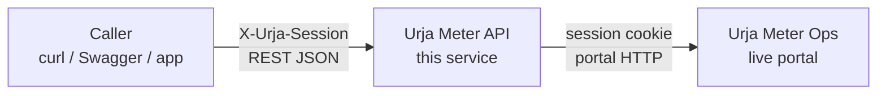
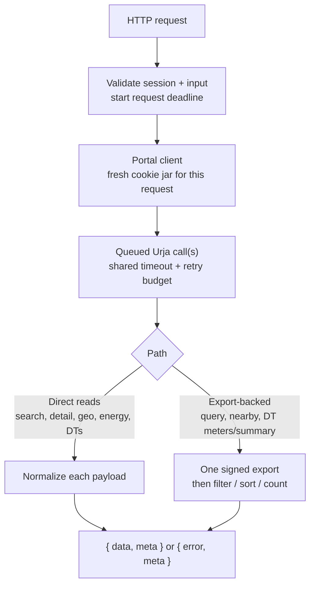
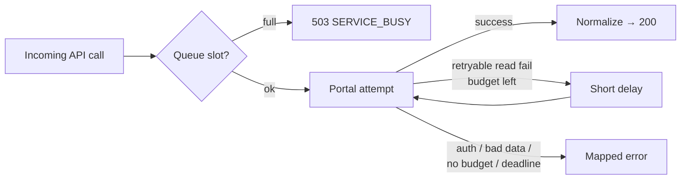

# Urja Meter API

Urja Meter Ops provides smart-meter details, network location, and recent readings through a web portal. There is no documented API for other applications, so users have to open the portal and copy the data manually.

Exploring its browser requests showed that the data was not always returned in the same format. Meter details had two different structures: an older parameter list and a newer nested JSON format, both inside SvelteKit's indexed responses. There were also missing hierarchy values, different names for the same transformer code, and reading timestamps with no stated timezone. Access depended on the portal's session cookie.

Urja Meter API is a Node.js service built around these findings. It handles portal authentication, converts the different response formats into consistent JSON, and reports source-data issues through warnings or errors. Other applications can access the data through documented endpoints without depending on the portal's web interface.

## Quick start

This service covers login and logout, meter search (one page or all pages), attribute filters, nearby search, nameplate, location, readings, transformers, and signed metadata export. Stack: **Node.js 24, Express, Zod**, plus **OpenAPI 3.1 / Swagger UI**. Calls go to the live portal — no DB setup.

You need Node.js 24, npm, and a valid Urja account. From the project folder:

```
npm ci
npm start
```

The server starts at `http://127.0.0.1:3000` by default. Open [Swagger UI](http://127.0.0.1:3000/docs), or follow the request examples below. `GET /health` checks that the service is running; it does not check Urja's availability. Optional settings are listed under [Configuration](#configuration).

## Using the API

Replace `YOUR_EMAIL` / `YOUR_PASSWORD` with your Urja login. JSON examples below are from a **live capture** against Urja on 30 October 2026 (`request_id` / `fetched_at` stripped). IDs, counts, and readings can change. Full capture: [LIVE_ENDPOINT_OUTPUTS.md](./LIVE_ENDPOINT_OUTPUTS.md).

You can also try everything in [Swagger UI](http://127.0.0.1:3000/docs). Full field list is in [openapi.json](./openapi.json).

| Method | Path                                  | What it does                            |
| ------ | ------------------------------------- | --------------------------------------- |
| `POST` | `/api/v1/auth/login`                  | Login, get session token                |
| `POST` | `/api/v1/auth/logout`                 | Revoke the current Urja session         |
| `GET`  | `/api/v1/meters`                      | Search meters (one page)                |
| `GET`  | `/api/v1/meters/all`                  | Search meters (all pages combined)      |
| `GET`  | `/api/v1/meters/query`                | Filter by status / phase / DT / etc.    |
| `GET`  | `/api/v1/meters/nearby`               | Meters near a lat/lng                   |
| `GET`  | `/api/v1/meters/{meter_id}`           | Nameplate details                       |
| `GET`  | `/api/v1/meters/{meter_id}/overview`  | Nameplate + location + readings summary |
| `GET`  | `/api/v1/meters/{meter_id}/location`  | Coordinates + network hierarchy         |
| `GET`  | `/api/v1/meters/{meter_id}/readings`  | Energy readings                         |
| `GET`  | `/api/v1/transformers`                | Transformer list                        |
| `GET`  | `/api/v1/transformers/{code}/meters`  | Meters on one transformer               |
| `GET`  | `/api/v1/transformers/{code}/summary` | Inventory counts for one transformer    |
| `GET`  | `/api/v1/meters/export`               | Full metadata snapshot (no readings)    |
| `GET`  | `/health`                             | Service up check                        |

Data calls need header: `X-Urja-Session: <session_token>` (no `Bearer` prefix).

---

### 1. Login

```bash
curl -sS 'http://127.0.0.1:3000/api/v1/auth/login' \
  -H 'Content-Type: application/json' \
  -d '{"email":"YOUR_EMAIL","password":"YOUR_PASSWORD"}'
```

```json
{
  "data": {
    "session_token": "<urja-session-cookie-value>",
    "expires_at": "2026-10-30T12:00:00.000Z"
  },
  "meta": { "request_id": "..." }
}
```

Save the token for later:

```bash
SESSION_TOKEN='<paste-session_token-here>'
```

Notes:

- Password is used only for login. It is not stored.
- Max **5 logins / minute / IP**.
- If session fails later, login again.
- In Swagger: login → copy token → **Authorize** → paste. Reload clears it.

---

### 2. Search (one page)

Search by meter ID or serial (full or partial):

```bash
curl -sS 'http://127.0.0.1:3000/api/v1/meters?q=J100007&page=1' \
  -H "X-Urja-Session: $SESSION_TOKEN"
```

```json
{
  "data": [
    {
      "meter_id": "J100007",
      "serial_number": "SE11409",
      "manufacturer": "Genus",
      "phase_type": "single",
      "installation_status": "decommissioned",
      "transformer_code": "DT-008"
    }
  ],
  "meta": {
    "source": "urja_portal",
    "page": 1,
    "page_size": 20,
    "total": 1,
    "total_pages": 1
  }
}
```

- Leave `q` empty to list meters.
- Change `page` for next page.
- Page size comes from Urja (we saw 20). You cannot set `page_size`.
- No match → `200` with `data: []`.
- `fetched_at` = when we called Urja, not how old the meter reading is.

---

### 3. Search all pages

Same search fields, but the API fetches every page and returns one list:

```bash
curl -sS 'http://127.0.0.1:3000/api/v1/meters/all?q=J100007' \
  -H "X-Urja-Session: $SESSION_TOKEN"
```

```json
{
  "data": [
    {
      "meter_id": "J100007",
      "serial_number": "SE11409",
      "manufacturer": "Genus",
      "phase_type": "single",
      "installation_status": "decommissioned",
      "transformer_code": "DT-008"
    }
  ],
  "meta": {
    "source": "urja_portal",
    "total": 1,
    "returned_count": 1,
    "page_size": 20,
    "pages_fetched": 1
  }
}
```

- Only `q` is allowed. Do not pass `page`.
- Empty `q` pulls the full search list (many portal calls).
- Need nameplate + hierarchy + coordinates for **all** meters? Use [export](#7-export-all-meter-metadata) instead.

---

### 4. Nameplate

```bash
curl -sS 'http://127.0.0.1:3000/api/v1/meters/J100007' \
  -H "X-Urja-Session: $SESSION_TOKEN"
```

```json
{
  "data": {
    "meter_id": "J100007",
    "serial_number": "SE11409",
    "manufacturer": "Genus",
    "phase_type": "single",
    "installation_status": "decommissioned",
    "installation_type": "ct_operated"
  },
  "meta": {
    "source": "urja_portal"
  }
}
```

Urja has two detail formats. We map both to the same fields. Unknown category → `unknown` + warning. Missing meter → `404`.

---

### 5. Location and hierarchy

```bash
curl -sS 'http://127.0.0.1:3000/api/v1/meters/J100007/location' \
  -H "X-Urja-Session: $SESSION_TOKEN"
```

```json
{
  "data": {
    "meter_id": "J100007",
    "coordinates": {
      "latitude": 26.832983556522617,
      "longitude": 75.803795527816
    },
    "hierarchy": {
      "zone": { "name": "Jaipur Zone 2", "code": "Z-02" },
      "circle": { "name": "Circle 2", "code": "C-02" },
      "division": { "name": "Division 8", "code": "D-08" },
      "subdivision": { "name": "Subdivision 8", "code": "SD-08" },
      "substation": { "name": "Substation 8", "code": "SS-08" },
      "feeder": { "name": "Feeder 8", "code": "F-008" },
      "transformer": { "name": "Tonk Road DT 8", "code": "DT-008" }
    }
  },
  "meta": {
    "source": "urja_portal"
  }
}
```

Missing levels may be `null` with a note in `meta.warnings`. We keep Urja names as-is (even if DT-007 had two different names in different places).

---

### 6. Readings

```bash
curl -sS 'http://127.0.0.1:3000/api/v1/meters/J100007/readings?from=2026-06-24T00:00:00&to=2026-06-24T00:30:00' \
  -H "X-Urja-Session: $SESSION_TOKEN"
```

```json
{
  "data": [
    {
      "timestamp": "2026-06-24T00:00:00",
      "active_energy_kwh": 30842.31,
      "apparent_energy_kvah": 33309.69,
      "voltage_r_v": 228
    },
    {
      "timestamp": "2026-06-24T00:30:00",
      "active_energy_kwh": 30842.65,
      "apparent_energy_kvah": 33310.06,
      "voltage_r_v": 226
    }
  ],
  "meta": {
    "source": "urja_portal",
    "meter_id": "J100007",
    "timestamp_timezone": null,
    "available_from": "2026-06-23T23:30:00",
    "available_to": "2026-06-30T23:30:00",
    "returned_count": 2
  }
}
```

- `from` / `to` format: `YYYY-MM-DDTHH:mm:ss` (no `Z`).
- Both ends are included. `from` must be `<=` `to`.
- Timezone is unknown, so `timestamp_timezone` is `null`.
- Filter only works on data Urja already returns.
- Values look like running totals — we do not sum them as bill/consumption.
- June dates above are from the live dataset. Change them if needed.

---

### 7. Transformers

```bash
curl -sS 'http://127.0.0.1:3000/api/v1/transformers?page=1' \
  -H "X-Urja-Session: $SESSION_TOKEN"
```

```json
{
  "data": [
    {
      "code": "DT-001",
      "name": "Malviya Nagar DT 1",
      "feeder_code": "F-001",
      "capacity_kva": 100
    },
    {
      "code": "DT-002",
      "name": "Mansarovar DT 2",
      "feeder_code": "F-002",
      "capacity_kva": 63
    }
  ],
  "meta": {
    "source": "urja_portal",
    "page": 1,
    "page_size": 20,
    "total": 40,
    "total_pages": 2
  }
}
```

Live page 1 returned 20 rows (`total: 40`). Sample above shows the first two.

---

### 8. Export all meter metadata

One signed call for nameplate + coordinates + hierarchy (not readings):

```bash
curl -sS 'http://127.0.0.1:3000/api/v1/meters/export' \
  -H "X-Urja-Session: $SESSION_TOKEN"
```

```json
{
  "data": [
    {
      "meter_id": "J100000",
      "serial_number": "SE33962",
      "manufacturer": "HPL",
      "phase_type": "single",
      "installation_status": "decommissioned",
      "installation_type": "whole_current",
      "transformer_code": "DT-001",
      "coordinates": {
        "latitude": 26.938961002479868,
        "longitude": 75.83095696146852
      },
      "hierarchy": {
        "zone": { "name": "Jaipur Zone 1", "code": "Z-01" },
        "circle": { "name": "Circle 1", "code": "C-01" },
        "division": { "name": "Division 1", "code": "D-01" },
        "subdivision": { "name": "Subdivision 1", "code": "SD-01" },
        "substation": { "name": "Substation 1", "code": "SS-01" },
        "feeder": { "name": "Feeder 1", "code": "F-001" },
        "transformer": { "name": "Malviya Nagar DT 1", "code": "DT-001" }
      }
    }
  ],
  "meta": {
    "source": "urja_portal",
    "total": 403,
    "returned_count": 403
  }
}
```

Live export returned **403** meters (count can change). Sample above is the first row; hierarchy gaps may appear in `meta.warnings`. Signing secret is never returned or logged. Dataset is not saved on disk.

**Search all vs export:** `/meters/all` = search list fields, optional `q`. `/meters/export` = full metadata snapshot for every meter.

---

### 9. Filter by attributes (`/query`)

Portal search only matches meter ID / serial. For ops filters (status + DT + phase, etc.), use this. It pulls one export, then filters locally (AND):

```bash
curl -sS 'http://127.0.0.1:3000/api/v1/meters/query?status=decommissioned&transformer_code=DT-008&page=1&page_size=5' \
  -H "X-Urja-Session: $SESSION_TOKEN"
```

```json
{
  "data": [
    {
      "meter_id": "J100007",
      "serial_number": "SE11409",
      "manufacturer": "Genus",
      "phase_type": "single",
      "installation_status": "decommissioned",
      "installation_type": "ct_operated",
      "transformer_code": "DT-008",
      "coordinates": {
        "latitude": 26.832983556522617,
        "longitude": 75.803795527816
      }
    },
    {
      "meter_id": "J100047",
      "serial_number": "SE12845",
      "manufacturer": "Secure",
      "phase_type": "three",
      "installation_status": "decommissioned",
      "installation_type": "ct_operated",
      "transformer_code": "DT-008",
      "coordinates": {
        "latitude": 26.88659656813145,
        "longitude": 75.86239808137547
      }
    },
    {
      "meter_id": "J100287",
      "serial_number": "AL45743",
      "manufacturer": "Allied",
      "phase_type": "three",
      "installation_status": "decommissioned",
      "installation_type": "ct_operated",
      "transformer_code": "DT-008",
      "coordinates": {
        "latitude": 26.899973646707462,
        "longitude": 75.69516136651878
      }
    }
  ],
  "meta": {
    "source": "urja_portal",
    "query_mode": "export_filter",
    "snapshot_total": 403,
    "matched_total": 3,
    "page": 1,
    "page_size": 5,
    "total_pages": 1,
    "filters": {
      "status": "decommissioned",
      "transformer_code": "DT-008"
    }
  }
}
```

Filters (at least one required): `status`, `phase_type`, `transformer_code`, `manufacturer`, `installation_type`.  
Paging: `page` (default 1), `page_size` (default 20, max 100). Rows are sorted by `meter_id`.

---

### 10. Nearby meters

Find meters close to a point (field staff use case):

```bash
curl -sS 'http://127.0.0.1:3000/api/v1/meters/nearby?latitude=26.83&longitude=75.80&radius_m=2000&limit=3' \
  -H "X-Urja-Session: $SESSION_TOKEN"
```

```json
{
  "data": [
    {
      "meter_id": "J100241",
      "serial_number": "SE23186",
      "manufacturer": "L&T",
      "phase_type": "three",
      "installation_status": "installed",
      "installation_type": "ct_operated",
      "transformer_code": "DT-002",
      "coordinates": {
        "latitude": 26.826995510868823,
        "longitude": 75.79881111110812
      },
      "distance_m": 354.3
    },
    {
      "meter_id": "J100007",
      "serial_number": "SE11409",
      "manufacturer": "Genus",
      "phase_type": "single",
      "installation_status": "decommissioned",
      "installation_type": "ct_operated",
      "transformer_code": "DT-008",
      "coordinates": {
        "latitude": 26.832983556522617,
        "longitude": 75.803795527816
      },
      "distance_m": 501.9
    },
    {
      "meter_id": "J100222",
      "serial_number": "SE59216",
      "manufacturer": "Genus",
      "phase_type": "single",
      "installation_status": "faulty",
      "installation_type": "ct_operated",
      "transformer_code": "DT-023",
      "coordinates": {
        "latitude": 26.83585317156287,
        "longitude": 75.79876188465646
      },
      "distance_m": 662.3
    }
  ],
  "meta": {
    "source": "urja_portal",
    "query_mode": "export_nearby",
    "snapshot_total": 403,
    "latitude": 26.83,
    "longitude": 75.8,
    "radius_m": 2000,
    "limit": 3,
    "matched_within_radius": 10,
    "returned_count": 3,
    "excluded_missing_coordinates": 0
  }
}
```

- Required: `latitude`, `longitude`
- Optional: `radius_m` (default 1000, max 50000), `limit` (default 50, max 200)
- Results sorted nearest first, with `distance_m` on each row
- Meters without coordinates are skipped; count is in `meta.excluded_missing_coordinates`

Also uses one export under the hood (`query_mode: "export_nearby"`).

---

### 11. Meter overview

One call for the usual “open this meter” screen (nameplate + location + readings summary):

```bash
curl -sS 'http://127.0.0.1:3000/api/v1/meters/J100007/overview' \
  -H "X-Urja-Session: $SESSION_TOKEN"
```

```json
{
  "data": {
    "meter_id": "J100007",
    "nameplate": {
      "serial_number": "SE11409",
      "manufacturer": "Genus",
      "phase_type": "single",
      "installation_status": "decommissioned",
      "installation_type": "ct_operated"
    },
    "location": {
      "coordinates": {
        "latitude": 26.832983556522617,
        "longitude": 75.803795527816
      },
      "hierarchy": {
        "zone": { "name": "Jaipur Zone 2", "code": "Z-02" },
        "circle": { "name": "Circle 2", "code": "C-02" },
        "division": { "name": "Division 8", "code": "D-08" },
        "subdivision": { "name": "Subdivision 8", "code": "SD-08" },
        "substation": { "name": "Substation 8", "code": "SS-08" },
        "feeder": { "name": "Feeder 8", "code": "F-008" },
        "transformer": { "name": "Tonk Road DT 8", "code": "DT-008" }
      }
    },
    "readings_summary": {
      "available_from": "2026-06-23T23:30:00",
      "available_to": "2026-06-30T23:30:00",
      "reading_count": 337,
      "timestamp_timezone": null,
      "latest_readings": [
        {
          "timestamp": "2026-06-30T23:30:00",
          "active_energy_kwh": 30957,
          "apparent_energy_kvah": 33433.56,
          "voltage_r_v": 226
        }
      ]
    }
  },
  "meta": {
    "source": "urja_portal",
    "composite": true,
    "note": "Combined from separate portal reads; not an atomic snapshot."
  }
}
```

Uses **three** portal reads on one shared session (detail, geo, energy) — not five.  
`latest_readings` keeps every row at the newest timestamp (duplicates included).  
This is **not** an atomic snapshot; timezone stays unknown. Empty energy → `reading_count: 0` and `latest_readings: []`.

---

### 12. Transformer meters and summary

```bash
curl -sS 'http://127.0.0.1:3000/api/v1/transformers/DT-008/meters?page=1&page_size=5' \
  -H "X-Urja-Session: $SESSION_TOKEN"

curl -sS 'http://127.0.0.1:3000/api/v1/transformers/DT-008/summary' \
  -H "X-Urja-Session: $SESSION_TOKEN"
```

Meters on `DT-008` (first page):

```json
{
  "data": [
    {
      "meter_id": "J100007",
      "serial_number": "SE11409",
      "manufacturer": "Genus",
      "phase_type": "single",
      "installation_status": "decommissioned",
      "installation_type": "ct_operated",
      "transformer_code": "DT-008",
      "coordinates": {
        "latitude": 26.832983556522617,
        "longitude": 75.803795527816
      }
    },
    {
      "meter_id": "J100047",
      "serial_number": "SE12845",
      "manufacturer": "Secure",
      "phase_type": "three",
      "installation_status": "decommissioned",
      "installation_type": "ct_operated",
      "transformer_code": "DT-008",
      "coordinates": {
        "latitude": 26.88659656813145,
        "longitude": 75.86239808137547
      }
    }
  ],
  "meta": {
    "source": "urja_portal",
    "query_mode": "transformer_meters",
    "transformer_code": "DT-008",
    "snapshot_total": 403,
    "assigned_total": 10,
    "matched_total": 10,
    "page": 1,
    "page_size": 5,
    "total_pages": 2,
    "filters": { "transformer_code": "DT-008" }
  }
}
```

Inventory summary:

```json
{
  "data": {
    "transformer_code": "DT-008",
    "total_meters": 10,
    "by_installation_status": {
      "installed": 7,
      "faulty": 0,
      "decommissioned": 3,
      "unknown": 0
    },
    "by_phase_type": {
      "single": 7,
      "three": 3,
      "unknown": 0
    }
  },
  "meta": {
    "source": "urja_portal",
    "query_mode": "transformer_summary",
    "transformer_code": "DT-008",
    "snapshot_total": 403,
    "assigned_total": 10
  }
}
```

- Path sets the transformer. Do not also pass `transformer_code` as a query param.
- `assigned_total` = all meters on that DT; `matched_total` = after optional `status` filter.
- Unknown DT (not in export and not in catalogue) → `404 TRANSFORMER_NOT_FOUND`.
- Summary is an **inventory** count (status + phase). It is not loading or health.

---

### 13. Logout

This calls Urja's sign-out endpoint and revokes the current session:

```bash
curl -sS -X POST 'http://127.0.0.1:3000/api/v1/auth/logout' \
  -H "X-Urja-Session: $SESSION_TOKEN"
```

```json
{
  "data": { "logged_out": true },
  "meta": {
    "source": "urja_portal",
    "request_id": "...",
    "fetched_at": "2026-10-30T00:00:00.000Z"
  }
}
```

The API returns success only after Urja confirms logout and clears its main session cookie. After that, protected routes reject the old session. Calling logout again with an already-revoked value may still return success (Urja's sign-out looked idempotent in live checks).

---

## Authentication decisions

I reuse Urja's session instead of a separate user store or JWT. Login returns the portal session value; callers send it as `X-Urja-Session`. That value is also a valid Urja cookie, so treat login responses and the header as secrets.

In testing, the same value worked as a cookie and was rejected as `Authorization: Bearer ...`. That supports the cookie flow used here; it does not prove what else Urja might accept.

Each resource request gets its own cookie jar. Portal calls for that request share the jar, timeout, and retry budget. Clients are not shared across callers. Credentials, session values, and export signing secrets are not logged.

Logout forwards the session to Urja's sign-out and succeeds only when Urja reports success and clears the main session cookie. After that, the old value is rejected on protected routes. Calling logout again with an already-revoked value may still return success (Urja's sign-out looked idempotent in live checks). Details are in [PROTOCOL.md](./PROTOCOL.md).

## Architecture

This service is an **adapter**, not a second source of truth: documented HTTP in, Urja session out, stable JSON back. Callers do not need SvelteKit or cookie details.

### Where it sits



No local database or response cache. `fetched_at` is when we called Urja, not how old a reading is. Investigation files are not used as a fallback.

### Inside one request



**Direct reads** hit the matching portal routes (overview reuses one jar for detail → geo → energy).  
**Export-backed** routes pull one signed snapshot, then answer filters or inventory locally — portal search only matches ID/serial.

```text
Direct:     Caller → API → Urja resource → normalize → JSON
Export:     Caller → API → Urja export  → filter/count → JSON
```

## Robustness and errors

Defaults (overridable in [Configuration](#configuration)):

| Limit | Default | If exceeded |
| --- | --- | --- |
| Active portal calls | 4 | Extra work waits in the queue |
| Queued portal calls | 20 | `503 SERVICE_BUSY` |
| Whole API operation | 30s (queue + attempts) | `504 PORTAL_TIMEOUT` |
| One portal attempt | 10s (incl. body) | Retry once if eligible, else fail |
| Normal response body | 1 MiB | `502` size / invalid response |
| Export body / rows | 5 MiB / 10,000 rows | `502 PORTAL_EXPORT_TOO_LARGE` |
| Login attempts | 5 / minute / IP | `429 RATE_LIMITED` |



Client disconnect cancels pending work. Eligible **reads** get **one** retry for the whole operation after a short randomized delay. Not retried: login, auth failures, rate limits, malformed payloads. Session cookie replaced or cleared mid-flight stops the call (`401`); sign in again. Export resigns each attempt (new timestamp + signature) — see [PROTOCOL.md](./PROTOCOL.md).

### Error shape

Failures use one envelope. Use `error.code` and `meta.request_id` (also in `X-Request-ID`):

```json
{
  "error": {
    "code": "PORTAL_SESSION_INVALID",
    "message": "Session rejected. Sign in again."
  },
  "meta": {
    "request_id": "423742c4-27cf-41bd-a353-1e962e86a054"
  }
}
```

| HTTP | Example codes | Caller action |
| --- | --- | --- |
| 400 | `INVALID_REQUEST` | Fix query/body |
| 401 | `UNAUTHORIZED`, `INVALID_CREDENTIALS`, `PORTAL_SESSION_INVALID`, `PORTAL_SESSION_CHANGED` | Fix credentials / session; login again |
| 403 | `FORBIDDEN` | Account cannot do this on Urja |
| 404 | `METER_NOT_FOUND`, `TRANSFORMER_NOT_FOUND`, `NOT_FOUND` | Check id / path |
| 429 | `RATE_LIMITED` | Back off login (our limiter) |
| 502 | `PORTAL_INVALID_RESPONSE`, `PORTAL_*_TOO_LARGE` | Bad/oversized Urja payload; quote `request_id` |
| 503 | `SERVICE_BUSY`, `PORTAL_UNAVAILABLE`, `PORTAL_RATE_LIMITED` | Retry later; honour `Retry-After` (1–60s when set) |
| 504 | `PORTAL_TIMEOUT` | Operation took too long; retry later |

Our login throttle is `429`. Urja rate-limiting the portal is `503 PORTAL_RATE_LIMITED`. Method and content-type rejects (`405` / `415`) are listed in [openapi.json](./openapi.json).

## Configuration

`.env` is **optional**. Defaults work with no file. To override service settings, copy [`.env.example`](./.env.example) to `.env`. `npm start` / `npm run dev` load it via Node's `--env-file-if-exists=.env`.

**Put in `.env`:** bind address, port, portal origin, timeouts, queue size, log level.  
**Do not put in `.env`:** Urja email, password, or session tokens. Those go in the login body / `X-Urja-Session` header (or `SMOKE_EMAIL` / `SMOKE_PASSWORD` only for `npm run test:live`).

| Variable | Default | Purpose |
| --- | --- | --- |
| `HOST` | `127.0.0.1` locally; `0.0.0.0` when `server` is set | Bind address |
| `PORT` | `3000` | HTTP port |
| `TRUST_PROXY` | `false` locally; `true` on Render | Trust `X-Forwarded-*` (login rate limit) |
| `PORTAL_ORIGIN` | `https://urja-ops.flockenergy.tech` | HTTPS origin only (no path, query, or embedded credentials) |
| `REQUEST_TIMEOUT_MS` | `30000` | Whole API operation deadline (100–120000) |
| `PORTAL_TIMEOUT_MS` | `10000` | One portal attempt (100–30000) |
| `PORTAL_MAX_CONCURRENCY` | `4` | Active portal requests (1–16) |
| `PORTAL_MAX_QUEUE` | `20` | Waiting portal requests (0–100) |
| `LOG_LEVEL` | `info` | `fatal` … `silent` |

Invalid values fail startup with a configuration error. On Render you usually only need the repo connected — leave `HOST` unset so it binds `0.0.0.0` and uses Render's `PORT`.

## Testing

Two layers, same idea as most API repos: a fast **offline** suite that never needs Urja, and an optional **live** smoke against the real portal.

### Offline (default CI path)

No credentials. A fake portal stands in for Urja so failure cases (timeouts, bad payloads, session changes, queue pressure) stay repeatable.

```bash
npm test              # Node's built-in test runner (unit / integration / contracts)
npm run lint
npm run format:check
npm run check:openapi # openapi.json parses and is internally consistent
```

What the suite focuses on:

- Input validation and documented error envelopes
- Normalizing mixed portal shapes (detail, location, readings, export, transformers)
- Caller isolation (separate cookie jars / sessions)
- Queue, retry, and deadline behaviour
- Export HMAC signing without leaking secrets into logs or responses
- Contract checks: success and error bodies match OpenAPI schemas

### Live smoke (optional)

Needs a running server and a real Urja account. Start the API, then in another terminal:

```bash
npm start
# other terminal:
SMOKE_EMAIL='YOUR_EMAIL' SMOKE_PASSWORD='YOUR_PASSWORD' npm run test:live
```

Exercises login, authenticated reads, export, pagination, logout, and common client errors against the live origin. Expect flakiness if Urja is down, rate-limited, or the dataset moved; treat live smoke as a release check, not as the day-to-day suite.

## Development

`npm run dev` starts the server in watch mode.

| Choice                               | Reason                                                                                                      |
| ------------------------------------ | ----------------------------------------------------------------------------------------------------------- |
| Node.js 24 and JavaScript ES modules | I am learning backend development in Node.js and chose it for this project.                                 |
| Express                              | A small routing layer is enough for the current endpoints.                                                  |
| Zod                                  | Validate caller input and expected portal response fields.                                                  |
| Axios and cookie-jar support         | Make portal requests and handle cookies without a shared login session.                                     |
| `devalue`                            | Decode SvelteKit's indexed payloads without executing response content or relying on a fixed node position. |
| Pino                                 | Record request IDs, status, and duration with controlled log fields.                                        |
| OpenAPI and Swagger UI               | Provide a clear contract and an interactive way to try the API.                                             |

```text
src/
  app.js, portal.js, queue.js   # HTTP surface, Urja client, concurrency
  resources.js, search.js       # detail / location / readings / search
  query.js, transformers.js     # export filters, nearby, DT inventory
  export.js, config.js, …       # signing, config, errors, logging
test/                           # offline unit, integration, contract tests
scripts/                        # OpenAPI check and live smoke
openapi.json                    # API contract
```

## Known limitations and future work

### Limits of this version

- Portal routes and payloads were learned by observation. Urja can change shapes or auth without notice; this adapter would need updates.
- Long-running session expiry, concurrent logins for one account, multi-session logout scope, signing-key rotation, and signature timestamp tolerance are only lightly checked. Offline mocks do not replace those portal lifecycle checks.
- Export `page=1` returned the full dataset in testing. The API checks completeness and does **not** invent further export pages. Larger datasets may need streaming or real pagination only after the portal is shown to support them.
- Queue and login limits are **per process**. Several instances would need shared throttling.
- Local bind defaults to loopback; Render (`RENDER` set) binds `0.0.0.0`. Public hosting still needs HTTPS (Render provides it), a deployment auth review, and an explicit CORS policy if browsers on other origins call the API (CORS alone is not access control).
- Attribute filters and nearby search already run on a **fresh export in memory**. There is still no durable local index, response cache, global hierarchy tree, or product UI — Swagger documents the API; it is not a meter dashboard.
- Readings keep source registers and an unknown timezone. Interval / billable energy is out of scope until cumulative-register rules are defined.

### Sensible next steps

1. **Durable export index** — Persist a validated export (for example SQLite), refresh atomically, and serve combined filters / nearby from the snapshot with visible `fetched_at` / snapshot id. Decide first whether snapshots are shared across any valid session or scoped to a principal; a shared DB must not widen Urja’s access model by accident.
2. **Caching** — Bounded in-memory cache of normalized responses only (never credentials or signing secrets). Pick a session-revalidation rule before shipping hits: check Urja on protected cache hits, or document a short trust window. Keep `fetched_at` as source retrieval time, not cache-read time.
3. **Network hierarchy API** — Build zone → … → transformer from export rows, keep aliases and missing codes honest, and optionally expose data-quality summaries (gaps, conflicts, missing coordinates).
4. **Small web client** — Same-origin login, search, detail, and readings with clear loading/empty/error/warning states. Map and tree views can follow once the basic flow works.
5. **Ops / scale (only if deploying)** — Shared limits across instances, readiness/drain, sanitized metrics (no secrets or meter IDs as labels), and CI for `npm ci`, tests, lint, format, and OpenAPI. Keep live-account smoke opt-in.

Do one optional track at a time: index **or** hierarchy first, then cache if repeated fetch cost warrants it, then UI.

## Reflection

### What assumptions did you make?

I started with browser requests as the integration source. I wanted to reuse Urja's login instead of creating a separate user system for this assignment. Cookie-only access was then checked against the resource endpoints. For readings, the implementation preserves the values and leaves the timezone unknown because there was not enough evidence to define either timezone or interval consumption.

### Which part was the most difficult, and how did you get unstuck?

The main difficulty was understanding meter detail responses. The same route could return legacy parameter lists or nested JSON, both inside SvelteKit's indexed format. Comparing installed, faulty, and decommissioned meters helped clarify that `installed_meter` is a payload key, not a check for installation status. The decoder selects data by its content rather than assuming a fixed node index.

### If you had another day, what would you improve?

I would first verify setup from a fresh clone and finish the documentation review. After that, I would start a durable export index for heavier filter/nearby workloads, and settle authorization plus snapshot freshness before adding caching.

### What mistake did you make while solving this?

I first assumed the portal session value could be reused as `Authorization: Bearer ...`, because that is a common API pattern and looked cleaner than copying a cookie. A protected search with only that header returned 401. Sending the same value as the `__Secure-better-auth.session_token` cookie worked. That pushed the design to `X-Urja-Session`: callers pass the cookie value in a header, and the adapter attaches it as a cookie on portal requests.

I also assumed session security could wait until later. Talking through cache access and logout made it clear that “who holds a valid Urja session” is part of the design even in this first version, which is why logout now goes through Urja's sign-out instead of only clearing a local variable.

### If you were reviewing your own submission, what would you criticise?

The service still depends on an undocumented portal interface, and real session expiry needs more investigation. Some transport and error-handling code is also quite detailed for a small assignment. I would check whether each piece has a clear reason and whether the documentation makes the remaining gaps easy to understand.

### Development assistance

I explored portal behaviour in Chrome DevTools, shared response samples, and chose Node.js, direct session reuse, and the initial extension scope. Codex assisted with protocol verification, architecture discussions, substantial implementation and test code, and documentation.

## Related work

Around two years ago, I built [YahooApi](https://github.com/piyushs-05/YahooApi) using Python, Requests, Beautiful Soup, and Flask to collect Yahoo Finance data for a project that needed an API. It supported company search, stock details, historical prices, quotes, and company comparisons.
