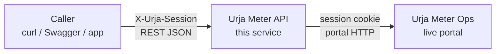
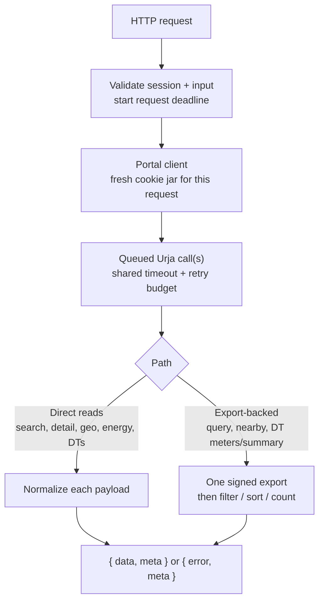
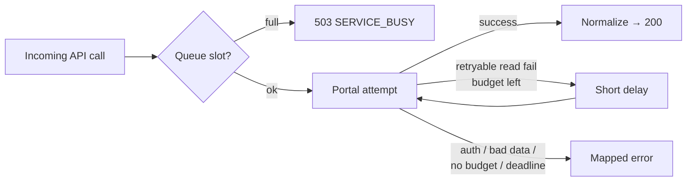

# Urja Meter API

Urja Meter Ops provides smart-meter details, network location, and recent readings through a web portal. There is no documented API for other applications, so users have to open the portal and copy the data manually.

Exploring its browser requests showed that the data was not always returned in the same format. Meter details had two different structures: an older parameter list and a newer nested JSON format, both inside SvelteKit's indexed responses. There were also missing hierarchy values, different names for the same transformer code, and reading timestamps with no stated timezone. Access depended on the portal's session cookie.

Urja Meter API is a Node.js service built around these findings. It handles portal authentication, converts the different response formats into consistent JSON, and reports source-data issues through warnings or errors. Other applications can access the data through documented endpoints without depending on the portal's web interface.

## Quick start

This service covers login and logout, meter search (one page or all pages), attribute filters, nearby search, nameplate, location, readings, transformers, and signed metadata export. Stack: **Node.js 24, Express, Zod**, plus **OpenAPI 3.1 / Swagger UI**. Calls go to the live portal — no DB setup.

**Hosted demo:** [https://api.piyushs.dev](https://api.piyushs.dev)  
Swagger UI: [https://api.piyushs.dev/docs](https://api.piyushs.dev/docs) · Health: [https://api.piyushs.dev/health](https://api.piyushs.dev/health)

Use your own Urja credentials at login. The demo is on Render’s free tier: after idle time the service sleeps, so the **first request can take ~30–60 seconds** (or longer) while it spins up. Later requests are fast until it sleeps again. It is not shut down permanently — it wakes on the next visit. The demo talks to the real Urja portal.

### Run locally

You need Node.js 24, npm, and a valid Urja account. From the project folder:

```
npm ci
npm start
```

The server starts at `http://127.0.0.1:3000` by default. Open [Swagger UI](http://127.0.0.1:3000/docs), or follow the request examples below (swap the host for `https://api.piyushs.dev` when calling the demo). `GET /health` checks that the service is running; it does not check Urja's availability. Optional settings are listed under [Configuration](#configuration).

## Using the API

Replace `YOUR_EMAIL` / `YOUR_PASSWORD` with your Urja login. Base URL in the curl samples is local; against the demo use `https://api.piyushs.dev` instead. JSON examples below are from a live capture against Urja (`request_id` / `fetched_at` stripped). IDs, counts, and readings can change.

Try the grouped endpoints in [Swagger on the demo](https://api.piyushs.dev/docs) (Auth, Search, Meters, Query, Transformers, Service) or locally at [http://127.0.0.1:3000/docs](http://127.0.0.1:3000/docs). Full field list is in [openapi.json](./openapi.json).

| Method | Path                                  | What it does                            |
| ------ | ------------------------------------- | --------------------------------------- |
| `POST` | `/api/v1/auth/login`                  | Login, get session token                |
| `POST` | `/api/v1/auth/logout`                 | Revoke the current Urja session         |
| `GET`  | `/api/v1/meters`                      | Search meters (one page)                |
| `GET`  | `/api/v1/meters/all`                  | Search meters (all pages combined)      |
| `GET`  | `/api/v1/meters/query`                | Filter by status / phase / DT / etc.    |
| `GET`  | `/api/v1/meters/nearby`               | Meters near a lat/lng                   |
| `GET`  | `/api/v1/meters/summary`              | Fleet inventory counts (status/phase/make) |
| `GET`  | `/api/v1/meters/{meter_id}`           | Nameplate details                       |
| `GET`  | `/api/v1/meters/{meter_id}/overview`  | Nameplate + location + readings summary |
| `GET`  | `/api/v1/meters/{meter_id}/location`  | Coordinates + network hierarchy         |
| `GET`  | `/api/v1/meters/{meter_id}/readings`  | Energy readings                         |
| `GET`  | `/api/v1/transformers`                | Transformer list                        |
| `GET`  | `/api/v1/transformers/{code}/meters`  | Meters on one transformer               |
| `GET`  | `/api/v1/transformers/{code}/summary` | Inventory counts for one transformer    |
| `GET`  | `/api/v1/meters/export`               | Full metadata snapshot (no readings)    |
| `GET`  | `/health`                             | Service up check                        |

Data calls need header: `X-Urja-Session: <session_token>` (no `Bearer` prefix).

---

### 1. Login

```bash
curl -sS 'http://127.0.0.1:3000/api/v1/auth/login' \
  -H 'Content-Type: application/json' \
  -d '{"email":"YOUR_EMAIL","password":"YOUR_PASSWORD"}'
```

```json
{
  "data": {
    "session_token": "<urja-session-cookie-value>",
    "expires_at": "2026-10-30T12:00:00.000Z"
  },
  "meta": { "request_id": "..." }
}
```

Save the token for later:

```bash
SESSION_TOKEN='<paste-session_token-here>'
```

Notes:

- Password is used only for login. It is not stored.
- Max **5 logins / minute / IP**.
- If session fails later, login again.
- In Swagger: login → copy token → **Authorize** → paste. Reload clears it.

---

### 2. Search (one page)

Search by meter ID or serial (full or partial):

```bash
curl -sS 'http://127.0.0.1:3000/api/v1/meters?q=J100007&page=1' \
  -H "X-Urja-Session: $SESSION_TOKEN"
```

```json
{
  "data": [
    {
      "meter_id": "J100007",
      "serial_number": "SE11409",
      "manufacturer": "Genus",
      "phase_type": "single",
      "installation_status": "decommissioned",
      "transformer_code": "DT-008"
    }
  ],
  "meta": {
    "source": "urja_portal",
    "page": 1,
    "page_size": 20,
    "total": 1,
    "total_pages": 1
  }
}
```

- Leave `q` empty to list meters.
- Change `page` for next page.
- Page size comes from Urja (we saw 20). You cannot set `page_size`.
- No match → `200` with `data: []`.
- `fetched_at` = when we called Urja, not how old the meter reading is.

---

### 3. Search all pages

Same search fields, but the API fetches every page and returns one list:

```bash
curl -sS 'http://127.0.0.1:3000/api/v1/meters/all?q=J100007' \
  -H "X-Urja-Session: $SESSION_TOKEN"
```

```json
{
  "data": [
    {
      "meter_id": "J100007",
      "serial_number": "SE11409",
      "manufacturer": "Genus",
      "phase_type": "single",
      "installation_status": "decommissioned",
      "transformer_code": "DT-008"
    }
  ],
  "meta": {
    "source": "urja_portal",
    "total": 1,
    "returned_count": 1,
    "page_size": 20,
    "pages_fetched": 1
  }
}
```

- Only `q` is allowed. Do not pass `page`.
- Empty `q` pulls the full search list (many portal calls).
- Need nameplate + hierarchy + coordinates for **all** meters? Use [export](#7-export-all-meter-metadata) instead.

---

### 4. Nameplate

```bash
curl -sS 'http://127.0.0.1:3000/api/v1/meters/J100007' \
  -H "X-Urja-Session: $SESSION_TOKEN"
```

```json
{
  "data": {
    "meter_id": "J100007",
    "serial_number": "SE11409",
    "manufacturer": "Genus",
    "phase_type": "single",
    "installation_status": "decommissioned",
    "installation_type": "ct_operated"
  },
  "meta": {
    "source": "urja_portal"
  }
}
```

Urja has two detail formats. We map both to the same fields. Unknown category → `unknown` + warning. Missing meter → `404`.

---

### 5. Location and hierarchy

```bash
curl -sS 'http://127.0.0.1:3000/api/v1/meters/J100007/location' \
  -H "X-Urja-Session: $SESSION_TOKEN"
```

```json
{
  "data": {
    "meter_id": "J100007",
    "coordinates": {
      "latitude": 26.832983556522617,
      "longitude": 75.803795527816
    },
    "hierarchy": {
      "zone": { "name": "Jaipur Zone 2", "code": "Z-02" },
      "circle": { "name": "Circle 2", "code": "C-02" },
      "division": { "name": "Division 8", "code": "D-08" },
      "subdivision": { "name": "Subdivision 8", "code": "SD-08" },
      "substation": { "name": "Substation 8", "code": "SS-08" },
      "feeder": { "name": "Feeder 8", "code": "F-008" },
      "transformer": { "name": "Tonk Road DT 8", "code": "DT-008" }
    }
  },
  "meta": {
    "source": "urja_portal"
  }
}
```

Missing levels may be `null` with a note in `meta.warnings`. We keep Urja names as-is (even if DT-007 had two different names in different places).

---

### 6. Readings

```bash
curl -sS 'http://127.0.0.1:3000/api/v1/meters/J100007/readings?from=2026-06-24T00:00:00&to=2026-06-24T00:30:00' \
  -H "X-Urja-Session: $SESSION_TOKEN"
```

```json
{
  "data": [
    {
      "timestamp": "2026-06-24T00:00:00",
      "active_energy_kwh": 30842.31,
      "apparent_energy_kvah": 33309.69,
      "voltage_r_v": 228
    },
    {
      "timestamp": "2026-06-24T00:30:00",
      "active_energy_kwh": 30842.65,
      "apparent_energy_kvah": 33310.06,
      "voltage_r_v": 226
    }
  ],
  "meta": {
    "source": "urja_portal",
    "meter_id": "J100007",
    "timestamp_timezone": null,
    "available_from": "2026-06-23T23:30:00",
    "available_to": "2026-06-30T23:30:00",
    "returned_count": 2
  }
}
```

- `from` / `to` format: `YYYY-MM-DDTHH:mm:ss` (no `Z`).
- Both ends are included. `from` must be `<=` `to`.
- For interpreting the readings, we assume IST (`Asia/Kolkata`, UTC+05:30). Urja did not provide a timezone, so this is an assumption; the API keeps `timestamp_timezone: null` and does not convert the source timestamps.
- Filter only works on data Urja already returns.
- Values look like running totals — we do not sum them as bill/consumption.
- June dates above are from the live dataset. Change them if needed.

---

### 7. Transformers

```bash
curl -sS 'http://127.0.0.1:3000/api/v1/transformers?page=1' \
  -H "X-Urja-Session: $SESSION_TOKEN"
```

```json
{
  "data": [
    {
      "code": "DT-001",
      "name": "Malviya Nagar DT 1",
      "feeder_code": "F-001",
      "capacity_kva": 100
    },
    {
      "code": "DT-002",
      "name": "Mansarovar DT 2",
      "feeder_code": "F-002",
      "capacity_kva": 63
    }
  ],
  "meta": {
    "source": "urja_portal",
    "page": 1,
    "page_size": 20,
    "total": 40,
    "total_pages": 2
  }
}
```

Live page 1 returned 20 rows (`total: 40`). Sample above shows the first two.

---

### 8. Export all meter metadata

One signed call for nameplate + coordinates + hierarchy (not readings):

```bash
curl -sS 'http://127.0.0.1:3000/api/v1/meters/export' \
  -H "X-Urja-Session: $SESSION_TOKEN"
```

```json
{
  "data": [
    {
      "meter_id": "J100000",
      "serial_number": "SE33962",
      "manufacturer": "HPL",
      "phase_type": "single",
      "installation_status": "decommissioned",
      "installation_type": "whole_current",
      "transformer_code": "DT-001",
      "coordinates": {
        "latitude": 26.938961002479868,
        "longitude": 75.83095696146852
      },
      "hierarchy": {
        "zone": { "name": "Jaipur Zone 1", "code": "Z-01" },
        "circle": { "name": "Circle 1", "code": "C-01" },
        "division": { "name": "Division 1", "code": "D-01" },
        "subdivision": { "name": "Subdivision 1", "code": "SD-01" },
        "substation": { "name": "Substation 1", "code": "SS-01" },
        "feeder": { "name": "Feeder 1", "code": "F-001" },
        "transformer": { "name": "Malviya Nagar DT 1", "code": "DT-001" }
      }
    }
  ],
  "meta": {
    "source": "urja_portal",
    "total": 403,
    "returned_count": 403
  }
}
```

Live export returned **403** meters (count can change). Sample above is the first row; hierarchy gaps may appear in `meta.warnings`. Signing secret is never returned or logged. Dataset is not saved on disk.

**Search all vs export:** `/meters/all` = search list fields, optional `q`. `/meters/export` = full metadata snapshot for every meter.

---

### 9. Filter by attributes (`/query`)

Portal search only matches meter ID / serial. For ops filters (status + DT + phase, etc.), use this. It pulls one export, then filters locally (AND):

```bash
curl -sS 'http://127.0.0.1:3000/api/v1/meters/query?status=decommissioned&transformer_code=DT-008&page=1&page_size=5' \
  -H "X-Urja-Session: $SESSION_TOKEN"
```

```json
{
  "data": [
    {
      "meter_id": "J100007",
      "serial_number": "SE11409",
      "manufacturer": "Genus",
      "phase_type": "single",
      "installation_status": "decommissioned",
      "installation_type": "ct_operated",
      "transformer_code": "DT-008",
      "coordinates": {
        "latitude": 26.832983556522617,
        "longitude": 75.803795527816
      }
    },
    {
      "meter_id": "J100047",
      "serial_number": "SE12845",
      "manufacturer": "Secure",
      "phase_type": "three",
      "installation_status": "decommissioned",
      "installation_type": "ct_operated",
      "transformer_code": "DT-008",
      "coordinates": {
        "latitude": 26.88659656813145,
        "longitude": 75.86239808137547
      }
    },
    {
      "meter_id": "J100287",
      "serial_number": "AL45743",
      "manufacturer": "Allied",
      "phase_type": "three",
      "installation_status": "decommissioned",
      "installation_type": "ct_operated",
      "transformer_code": "DT-008",
      "coordinates": {
        "latitude": 26.899973646707462,
        "longitude": 75.69516136651878
      }
    }
  ],
  "meta": {
    "source": "urja_portal",
    "query_mode": "export_filter",
    "snapshot_total": 403,
    "matched_total": 3,
    "page": 1,
    "page_size": 5,
    "total_pages": 1,
    "filters": {
      "status": "decommissioned",
      "transformer_code": "DT-008"
    }
  }
}
```

Filters (at least one required): `status`, `phase_type`, `transformer_code`, `manufacturer`, `installation_type`.  
Paging: `page` (default 1), `page_size` (default 20, max 100). Rows are sorted by `meter_id`.

---

### 10. Nearby meters

Find meters close to a point (field staff use case):

```bash
curl -sS 'http://127.0.0.1:3000/api/v1/meters/nearby?latitude=26.83&longitude=75.80&radius_m=2000&limit=3' \
  -H "X-Urja-Session: $SESSION_TOKEN"
```

```json
{
  "data": [
    {
      "meter_id": "J100241",
      "serial_number": "SE23186",
      "manufacturer": "L&T",
      "phase_type": "three",
      "installation_status": "installed",
      "installation_type": "ct_operated",
      "transformer_code": "DT-002",
      "coordinates": {
        "latitude": 26.826995510868823,
        "longitude": 75.79881111110812
      },
      "distance_m": 354.3
    },
    {
      "meter_id": "J100007",
      "serial_number": "SE11409",
      "manufacturer": "Genus",
      "phase_type": "single",
      "installation_status": "decommissioned",
      "installation_type": "ct_operated",
      "transformer_code": "DT-008",
      "coordinates": {
        "latitude": 26.832983556522617,
        "longitude": 75.803795527816
      },
      "distance_m": 501.9
    },
    {
      "meter_id": "J100222",
      "serial_number": "SE59216",
      "manufacturer": "Genus",
      "phase_type": "single",
      "installation_status": "faulty",
      "installation_type": "ct_operated",
      "transformer_code": "DT-023",
      "coordinates": {
        "latitude": 26.83585317156287,
        "longitude": 75.79876188465646
      },
      "distance_m": 662.3
    }
  ],
  "meta": {
    "source": "urja_portal",
    "query_mode": "export_nearby",
    "snapshot_total": 403,
    "latitude": 26.83,
    "longitude": 75.8,
    "radius_m": 2000,
    "limit": 3,
    "matched_within_radius": 10,
    "returned_count": 3,
    "excluded_missing_coordinates": 0
  }
}
```

- Required: `latitude`, `longitude`
- Optional: `radius_m` (default 1000, max 50000), `limit` (default 50, max 200)
- Results sorted nearest first, with `distance_m` on each row
- Meters without coordinates are skipped; count is in `meta.excluded_missing_coordinates`

Also uses one export under the hood (`query_mode: "export_nearby"`).

---

### 11. Fleet inventory summary

One export, then counts for a dashboard:

```bash
curl -sS 'http://127.0.0.1:3000/api/v1/meters/summary' \
  -H "X-Urja-Session: $SESSION_TOKEN"
```

```json
{
  "data": {
    "total_meters": 403,
    "by_installation_status": {
      "installed": 238,
      "faulty": 90,
      "decommissioned": 75,
      "unknown": 0
    },
    "by_phase_type": {
      "single": 277,
      "three": 126,
      "unknown": 0
    },
    "by_manufacturer": {
      "HPL": 90,
      "L&T": 64,
      "Genus": 88,
      "Allied": 76,
      "Secure": 85
    }
  },
  "meta": {
    "source": "urja_portal",
    "query_mode": "export_summary",
    "snapshot_total": 403
  }
}
```

Counts above are from a live run (each breakdown sums to 403). No query parameters. Inventory only — not loading or health. Registered as a static path so `summary` is not treated as a meter ID.

---

### 12. Meter overview

One call for the usual “open this meter” screen (nameplate + location + readings summary):

```bash
curl -sS 'http://127.0.0.1:3000/api/v1/meters/J100007/overview' \
  -H "X-Urja-Session: $SESSION_TOKEN"
```

```json
{
  "data": {
    "meter_id": "J100007",
    "nameplate": {
      "serial_number": "SE11409",
      "manufacturer": "Genus",
      "phase_type": "single",
      "installation_status": "decommissioned",
      "installation_type": "ct_operated"
    },
    "location": {
      "coordinates": {
        "latitude": 26.832983556522617,
        "longitude": 75.803795527816
      },
      "hierarchy": {
        "zone": { "name": "Jaipur Zone 2", "code": "Z-02" },
        "circle": { "name": "Circle 2", "code": "C-02" },
        "division": { "name": "Division 8", "code": "D-08" },
        "subdivision": { "name": "Subdivision 8", "code": "SD-08" },
        "substation": { "name": "Substation 8", "code": "SS-08" },
        "feeder": { "name": "Feeder 8", "code": "F-008" },
        "transformer": { "name": "Tonk Road DT 8", "code": "DT-008" }
      }
    },
    "readings_summary": {
      "available_from": "2026-06-23T23:30:00",
      "available_to": "2026-06-30T23:30:00",
      "reading_count": 337,
      "timestamp_timezone": null,
      "latest_readings": [
        {
          "timestamp": "2026-06-30T23:30:00",
          "active_energy_kwh": 30957,
          "apparent_energy_kvah": 33433.56,
          "voltage_r_v": 226
        }
      ]
    }
  },
  "meta": {
    "source": "urja_portal",
    "composite": true,
    "note": "Combined from separate portal reads; not an atomic snapshot."
  }
}
```

Uses **three** portal reads on one shared session (detail, geo, energy) — not five.  
`latest_readings` keeps every row at the newest timestamp (duplicates included).  
This is **not** an atomic snapshot; timezone stays unknown. Empty energy → `reading_count: 0` and `latest_readings: []`.

---

### 13. Transformer meters and summary

```bash
curl -sS 'http://127.0.0.1:3000/api/v1/transformers/DT-008/meters?page=1&page_size=5' \
  -H "X-Urja-Session: $SESSION_TOKEN"

curl -sS 'http://127.0.0.1:3000/api/v1/transformers/DT-008/summary' \
  -H "X-Urja-Session: $SESSION_TOKEN"
```

Meters on `DT-008` (first page):

```json
{
  "data": [
    {
      "meter_id": "J100007",
      "serial_number": "SE11409",
      "manufacturer": "Genus",
      "phase_type": "single",
      "installation_status": "decommissioned",
      "installation_type": "ct_operated",
      "transformer_code": "DT-008",
      "coordinates": {
        "latitude": 26.832983556522617,
        "longitude": 75.803795527816
      }
    },
    {
      "meter_id": "J100047",
      "serial_number": "SE12845",
      "manufacturer": "Secure",
      "phase_type": "three",
      "installation_status": "decommissioned",
      "installation_type": "ct_operated",
      "transformer_code": "DT-008",
      "coordinates": {
        "latitude": 26.88659656813145,
        "longitude": 75.86239808137547
      }
    }
  ],
  "meta": {
    "source": "urja_portal",
    "query_mode": "transformer_meters",
    "transformer_code": "DT-008",
    "snapshot_total": 403,
    "assigned_total": 10,
    "matched_total": 10,
    "page": 1,
    "page_size": 5,
    "total_pages": 2,
    "filters": { "transformer_code": "DT-008" }
  }
}
```

Inventory summary:

```json
{
  "data": {
    "transformer_code": "DT-008",
    "total_meters": 10,
    "by_installation_status": {
      "installed": 7,
      "faulty": 0,
      "decommissioned": 3,
      "unknown": 0
    },
    "by_phase_type": {
      "single": 7,
      "three": 3,
      "unknown": 0
    }
  },
  "meta": {
    "source": "urja_portal",
    "query_mode": "transformer_summary",
    "transformer_code": "DT-008",
    "snapshot_total": 403,
    "assigned_total": 10
  }
}
```

- Path sets the transformer. Do not also pass `transformer_code` as a query param.
- `assigned_total` = all meters on that DT; `matched_total` = after optional `status` filter.
- Unknown DT (not in export and not in catalogue) → `404 TRANSFORMER_NOT_FOUND`.
- Summary is an **inventory** count (status + phase). It is not loading or health.

---

### 14. Logout

This calls Urja's sign-out endpoint and revokes the current session:

```bash
curl -sS -X POST 'http://127.0.0.1:3000/api/v1/auth/logout' \
  -H "X-Urja-Session: $SESSION_TOKEN"
```

```json
{
  "data": { "logged_out": true },
  "meta": {
    "source": "urja_portal",
    "request_id": "...",
    "fetched_at": "2026-10-30T00:00:00.000Z"
  }
}
```

The API returns success only after Urja confirms logout and clears its main session cookie. After that, protected routes reject the old session.

---

## Authentication decisions

I reuse Urja's session instead of a separate user store or JWT. Login returns the portal session value; callers send it as `X-Urja-Session`. That value is also a valid Urja cookie, so treat login responses and the header as secrets.

In testing, the same value worked as a cookie and was rejected as `Authorization: Bearer ...`. That supports the cookie flow used here; it does not prove what else Urja might accept.

Each resource request gets its own cookie jar. Portal calls for that request share the jar, timeout, and retry budget. Clients are not shared across callers. Credentials, session values, and export signing secrets are not logged.

Logout forwards the session to Urja's sign-out and succeeds only when Urja reports success and clears the main session cookie. After that, the old value is rejected on protected routes. Details are in [PROTOCOL.md](./PROTOCOL.md).

## Architecture

This service is an **adapter**, not a second source of truth: documented HTTP in, Urja session out, stable JSON back. Callers do not need SvelteKit or cookie details.

### Where it sits



No local database or response cache. `fetched_at` is when we called Urja, not how old a reading is. Investigation files are not used as a fallback.

### Inside one request



**Direct reads** hit the matching portal routes (overview reuses one jar for detail → geo → energy).  
**Export-backed** routes pull one signed snapshot, then answer filters or inventory locally — portal search only matches ID/serial.

```text
Direct:     Caller → API → Urja resource → normalize → JSON
Export:     Caller → API → Urja export  → filter/count → JSON
```

## Robustness and errors

Defaults (overridable in [Configuration](#configuration)):

| Limit | Default | If exceeded |
| --- | --- | --- |
| Active portal calls | 4 | Extra work waits in the queue |
| Queued portal calls | 20 | `503 SERVICE_BUSY` |
| Whole API operation | 30s (queue + attempts) | `504 PORTAL_TIMEOUT` |
| One portal attempt | 10s (incl. body) | Retry once if eligible, else fail |
| Normal response body | 1 MiB | `502` size / invalid response |
| Export body / rows | 5 MiB / 10,000 rows | `502 PORTAL_EXPORT_TOO_LARGE` |
| Login attempts | 5 / minute / IP | `429 RATE_LIMITED` |



Client disconnect cancels pending work. Eligible **reads** get **one** retry for the whole operation after a short randomized delay. Not retried: login, auth failures, rate limits, malformed payloads. Session cookie replaced or cleared mid-flight stops the call (`401`); sign in again. Export resigns each attempt (new timestamp + signature) — see [PROTOCOL.md](./PROTOCOL.md).

### Error shape

Failures use one envelope. Use `error.code` and `meta.request_id` (also in `X-Request-ID`):

```json
{
  "error": {
    "code": "PORTAL_SESSION_INVALID",
    "message": "Session rejected. Sign in again."
  },
  "meta": {
    "request_id": "423742c4-27cf-41bd-a353-1e962e86a054"
  }
}
```

| HTTP | Example codes | Caller action |
| --- | --- | --- |
| 400 | `INVALID_REQUEST` | Fix query/body |
| 401 | `UNAUTHORIZED`, `INVALID_CREDENTIALS`, `PORTAL_SESSION_INVALID`, `PORTAL_SESSION_CHANGED` | Fix credentials / session; login again |
| 403 | `FORBIDDEN` | Account cannot do this on Urja |
| 404 | `METER_NOT_FOUND`, `TRANSFORMER_NOT_FOUND`, `NOT_FOUND` | Check id / path |
| 429 | `RATE_LIMITED` | Back off login (our limiter) |
| 502 | `PORTAL_INVALID_RESPONSE`, `PORTAL_*_TOO_LARGE` | Bad/oversized Urja payload; quote `request_id` |
| 503 | `SERVICE_BUSY`, `PORTAL_UNAVAILABLE`, `PORTAL_RATE_LIMITED` | Retry later; honour `Retry-After` (1–60s when set) |
| 504 | `PORTAL_TIMEOUT` | Operation took too long; retry later |

Our login throttle is `429`. Urja rate-limiting the portal is `503 PORTAL_RATE_LIMITED`. Method and content-type rejects (`405` / `415`) are listed in [openapi.json](./openapi.json).

## Configuration

`.env` is **optional**. Defaults work with no file. To override service settings, copy [`.env.example`](./.env.example) to `.env`. `npm start` / `npm run dev` load it via Node's `--env-file-if-exists=.env`.

**Put in `.env`:** bind address, port, portal origin, timeouts, queue size, log level.  
**Do not put in `.env`:** Urja email, password, or session tokens. Those go in the login body / `X-Urja-Session` header (or `SMOKE_EMAIL` / `SMOKE_PASSWORD` only for `npm run test:live`).

| Variable | Default | Purpose |
| --- | --- | --- |
| `HOST` | `127.0.0.1` locally; `0.0.0.0` on Render | Bind address |
| `PORT` | `3000` | HTTP port |
| `TRUST_PROXY` | `false` locally; `true` on Render | Trust `X-Forwarded-*` (login rate limit) |
| `PORTAL_ORIGIN` | `https://urja-ops.flockenergy.tech` | HTTPS origin only (no path, query, or embedded credentials) |
| `REQUEST_TIMEOUT_MS` | `30000` | Whole API operation deadline (100–120000) |
| `PORTAL_TIMEOUT_MS` | `10000` | One portal attempt (100–30000) |
| `PORTAL_MAX_CONCURRENCY` | `4` | Active portal requests (1–16) |
| `PORTAL_MAX_QUEUE` | `20` | Waiting portal requests (0–100) |
| `LOG_LEVEL` | `info` | `fatal` … `silent` |

Invalid values fail startup with a configuration error. On Render you usually only need the repo connected — leave `HOST` unset so it binds `0.0.0.0` and uses Render's `PORT`.

## Testing

Two layers, same idea as most API repos: a fast **offline** suite that never needs Urja, and an optional **live** smoke against the real portal.

### Offline (default CI path)

No credentials. A fake portal stands in for Urja so failure cases (timeouts, bad payloads, session changes, queue pressure) stay repeatable.

```bash
npm test              # Node's built-in test runner (unit / integration / contracts)
npm run lint
npm run format:check
npm run check:openapi # openapi.json parses and is internally consistent
```

What the suite focuses on:

- Input validation and documented error envelopes
- Normalizing mixed portal shapes (detail, location, readings, export, transformers)
- Caller isolation (separate cookie jars / sessions)
- Queue, retry, and deadline behaviour
- Export HMAC signing without leaking secrets into logs or responses
- Contract checks: success and error bodies match OpenAPI schemas

### Live smoke (optional)

Needs a running server and a real Urja account. Start the API, then in another terminal:

```bash
npm start
# other terminal:
SMOKE_EMAIL='YOUR_EMAIL' SMOKE_PASSWORD='YOUR_PASSWORD' npm run test:live
```

Exercises login, authenticated reads, export, pagination, logout, and common client errors against the live origin. Expect flakiness if Urja is down, rate-limited, or the dataset moved; treat live smoke as a release check, not as the day-to-day suite.

## Development

`npm run dev` starts the server in watch mode.

| Choice                               | Reason                                                                                                      |
| ------------------------------------ | ----------------------------------------------------------------------------------------------------------- |
| Node.js 24 and JavaScript ES modules | I am learning backend development in Node.js and chose it for this project.                                 |
| Express                              | A small routing layer is enough for the current endpoints.                                                  |
| Zod                                  | Validate caller input and expected portal response fields.                                                  |
| Axios and cookie-jar support         | Make portal requests and handle cookies without a shared login session.                                     |
| `devalue`                            | Decode SvelteKit's indexed payloads without executing response content or relying on a fixed node position. |
| Pino                                 | Record request IDs, status, and duration with controlled log fields.                                        |
| OpenAPI and Swagger UI               | Provide a clear contract and an interactive way to try the API.                                             |

```text
src/
  app.js, portal.js, queue.js   # HTTP surface, Urja client, concurrency
  resources.js, search.js       # detail / location / readings / search
  query.js, transformers.js     # export filters, nearby, DT inventory
  export.js, config.js, …       # signing, config, errors, logging
test/                           # offline unit, integration, contract tests
scripts/                        # OpenAPI check and live smoke
openapi.json                    # API contract
```

## What I found while exploring Urja

- **Meter details have two formats.** Some responses contain a parameter list, while others contain nested JSON inside `classData`. Both are inside SvelteKit's indexed response. The API handles both formats, and automated tests check that they produce the same fields. A new format would need another decoder update.
- **Network data has gaps and different names.** For example, DT-007 had different names in the meter hierarchy and transformer list. The API keeps the source names and reports missing values through warnings. It does not choose one name as the correct one without evidence.
- **The export gave us more than the search list.** In live testing, export `page=1` returned all 403 meter records, including hierarchy and coordinates. The API checks the returned count and rejects incomplete or duplicate records. This was tested with the current dataset; export pagination for a larger dataset has not been verified.
- **Readings need some care.** J100007 returned 337 readings in the live test. Sorting and inclusive date filters were checked. Since Urja did not provide a timezone, we assume IST when interpreting these readings, but keep the API timezone field as `null` because it is not confirmed by the source. The energy values appear to be cumulative readings. Calculating daily usage or bills would also need confirmed rules for meter resets and units.
- **Filters currently fetch the dataset again on each request.** Status filters, nearby search, and transformer inventory use a fresh export in memory. This keeps the flow simple, but repeated requests repeat the export work. There is no saved index or response cache yet.

### What I would improve next

1. **Save a searchable meter snapshot.** Store a validated export in SQLite so filters and nearby searches can use it without downloading all meters each time. Refresh it on a fixed schedule and show when it was last updated. If a refresh fails, keep the previous complete snapshot and clearly show its age. Saved data should remain available only to users who are allowed to access it.
2. **Add caching for repeated lookups.** Keep frequently requested meter details for a short, configurable time. Return the original fetch time so callers can see how old the data is. Before serving cached data, check that the caller's Urja session is still valid. Start with one resource and measure whether it reduces repeated portal calls.
3. **Make network browsing easier.** Add endpoints to list zones, feeders, and their transformers using the export data. Keep missing levels and alternate names visible. This would help callers browse the network without building the hierarchy themselves.
4. **Multi-session login.** Check how Urja handles the same account logged in on multiple devices, including whether logging out on one device affects the others.
5. **Add a small web interface and automatic checks.** A basic page could provide login, search, meter overview, and a readings chart. Separately, add GitHub Actions to run tests, lint, formatting, and OpenAPI validation on each push.

I would start with the saved meter snapshot because several existing endpoints already depend on export. If the service later runs on multiple instances, the queue and login limits would also need to be coordinated; currently each process keeps its own limits.

## Reflection

### What assumptions did you make?

- **Timezone:** I assume IST when interpreting the readings because the utility data is from Jaipur. Urja does not state a timezone, so the API preserves the original timestamps and returns `timestamp_timezone: null`.
- **Energy readings:** The increasing kWh and kVAh values appear to be cumulative readings. Reset and rollover rules are not confirmed, so the API does not calculate interval consumption or bills.
- **Transformer identity:** I use transformer codes to link meters with transformers. If the same code has different names, the API keeps the source names rather than treating them as separate transformers.
- **Installation status:** I treat `installed`, `faulty`, and `decommissioned` as inventory labels. They do not establish whether a meter is currently online or whether its readings are correct.
- **Data during multiple calls:** Search across pages and meter overview use several portal calls. I assume the data stays reasonably stable while these calls run. The API checks for some inconsistencies, but cannot guarantee that every response represents the same point in time.

#### Assumptions later verified

- **Session reuse** - I initially expected the portal session cookie to be enough for resource access. Requests using only that cookie succeeded, while sending the same value only as a Bearer token returned 401.
- **Complete export** - I initially expected the export to provide all meter metadata together. The live export returned 403 records with a matching total, and the API checks completeness and duplicate IDs. This was verified for the current dataset.

### Which part was the most difficult, and how did you get unstuck?

The most difficult part was understanding why meter details were coming in different formats. Some meters returned a parameter list, while others returned nested JSON inside `classData`. Both were inside SvelteKit's indexed response, so reading the response directly was confusing.

I compared responses from several meters with different installation statuses in Chrome DevTools. This helped me understand that the format should be identified from the response structure, rather than guessed from the meter's status. For example, `installed_meter` also appeared for a decommissioned meter, so the name did not mean the meter was installed.

Based on these observations, the decoder handles both formats and converts them into the same API response.

### If you had another day, what would you improve?

I would first add a short-lived cache for the validated meter export. Status filters, nearby search, and transformer summaries currently fetch the export separately on every request. Reusing a recent export would reduce repeated portal calls. The response would show when the data was fetched, and callers could request a refresh when needed. Cached data would still require a valid Urja session, with entries kept separate between sessions.

I would then build a small UI combining inventory counts, meter overview, readings, and transformer data. A map would help users find nearby meters, filter them by installation status, and select a meter to see its details and transformer assignment. I would add a map endpoint that returns compact markers within the visible area, so the frontend does not need to download the full export.

### What mistake did you make while solving this?

I first assumed the portal session value could be reused as `Authorization: Bearer ...`, because that is a common API pattern and looked cleaner than copying a cookie. A protected search with only that header returned 401. Sending the same value as the `__Secure-better-auth.session_token` cookie worked. That pushed the design to `X-Urja-Session`: callers pass the cookie value in a header, and the adapter attaches it as a cookie on portal requests.

I also missed logout in the initial endpoint list. At first, the flow covered getting a session and using it, but not ending it. Clearing a local token would still leave the Urja session active. I added logout after checking the portal's sign-out request and verified that the old session was rejected afterward.

### If you were reviewing your own submission, what would you criticise?

I would review how much work the API removes for another developer. Normalizing the portal responses is useful, but callers should also be able to complete common tasks without rebuilding the same logic. The meter overview combines details, location, and recent-reading information, while attribute filters, nearby search, and transformer summaries support practical inspection and inventory tasks.

My criticism would be that some useful responses still require downloading the full export internally on every request. Before adding more endpoints, I would measure response times and portal calls, then improve how existing endpoints share recently fetched data. I would also check that pagination, warnings, and freshness information are clear enough for a developer to use the results correctly. The next endpoints should come from real user tasks, such as finding incomplete meter records, rather than adding more ways to return the same data.

### Development assistance

I explored the portal in Chrome DevTools, collected response samples, and shaped the API around practical tasks such as meter lookup, filtering, and transformer inspection. I used an AI agent to challenge design choices, verify protocol assumptions, and assist with implementation, tests, and documentation. Throughout the process, I questioned recommendations, reviewed live responses, and refined the scope and authentication flow. This helped me evaluate the suggested solutions rather than accept them without understanding the trade-offs.

## Related work

Around two years ago, I built [YahooApi](https://github.com/piyushs-05/YahooApi) for a project that needed stock-market data. I first inspected Yahoo Finance to understand how the website displayed the required information, then used Python, Requests, and Beautiful Soup to extract it and built Flask endpoints for company search, stock details, historical prices, quotes, and comparisons.
